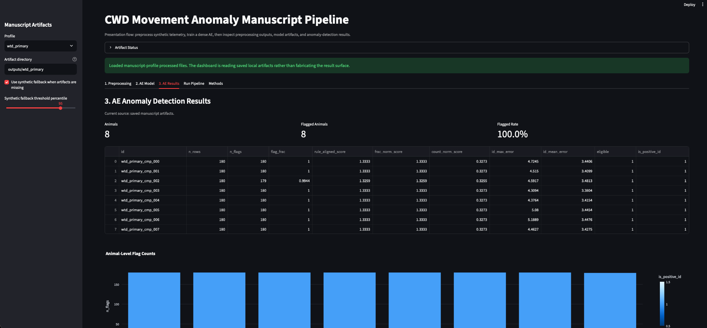

# Case Study: CWD Movement Anomaly Detection From Cervid GPS Telemetry

## Executive Summary

This project demonstrates a scientific machine-learning workflow for detecting chronic
wasting disease (CWD)-associated movement anomalies from cervid GPS telemetry.

The core technical problem is not simply "train a model on GPS points." The real problem is
building a defensible pipeline that can handle repeated observations from the same animal,
irregular telemetry schedules, biologically meaningful feature engineering, leakage-safe
validation, frozen thresholds, and interpretation at both the GPS-fix and animal levels.

The public repository contains three layers:

1. **Original manuscript code snapshots**: public-safe versions of the notebooks and R
   Markdown files used for the mule deer publication workflow and white-tailed deer draft
   workflow.
2. **Reusable public pipeline**: cleaned Python/R scripts that reproduce the workflow shape
   without protected telemetry, exact animal IDs, local agency paths, or unpublished split
   manifests.
3. **Synthetic dashboard demonstration**: a runnable public demo that preprocesses
   synthetic telemetry-shaped data, trains an autoencoder, and displays preprocessing,
   model, and anomaly-detection artifacts.

## Research Context

The mule deer anomaly-detection workflow represented here supported the peer-reviewed
Movement Ecology publication:

Blaha, R. L. et al. (2026). [Use of deep learning to predict chronic wasting disease status
based on animal movement](https://link.springer.com/article/10.1186/s40462-026-00668-4).
Movement Ecology, 14, Article 57.

The white-tailed deer workflow extends the same machine-learning approach for a draft
manuscript being prepared for peer review. That draft evaluates whether an autoencoder
trained on CWD-negative white-tailed deer movement can identify CWD-positive animals from
movement anomalies.

## Role and Technical Scope

This work combines:

- wildlife telemetry preprocessing in R;
- Python machine-learning pipelines;
- TensorFlow/Keras autoencoder modeling;
- animal-level validation design;
- reconstruction-error interpretation;
- public-safe software packaging and documentation.

The public repository is designed to show the engineering and analytical decisions behind
the research while respecting data-use boundaries.

## Source Workflows

The original manuscript workflows are preserved under:

`research_archive/original_manuscript_code/`

Key source families include:

| Study family | Source workflows | Public-safe role |
| --- | --- | --- |
| White-tailed deer preprocessing | `White_Tailed_Deer_REDO3.Rmd`, `Relocation_Analysis.Rmd`, `Combo_AKDE_Results.Rmd`, `AKDE_REVIEW.Rmd` | Telemetry cleaning, fix diagnostics, AKDE joins, movement review |
| White-tailed deer autoencoder | `autoencoder_100.ipynb`, `autoencoder_100_4pings.ipynb`, `WTD_Autoencoder_4hours.ipynb` | Primary and sensitivity AE experiments |
| Mule deer autoencoder | `60_40_Experiment.ipynb`, `100_Experiment_2 copy.ipynb`, infection-prevalence notebooks | Published mule deer AE workflow and sensitivity experiments |
| Cross-species experiments | `Mule_WTD_Normalization.Rmd`, genotype-transfer notebooks | Regularization and transfer-design experiments |

Notebook outputs were cleared and local machine paths were redacted before publication to
avoid exposing stale outputs, protected telemetry, or private local file structure.

## Data Workflow

The analytical pipeline starts with raw GPS telemetry and transforms it into model-ready
movement features.

Core preprocessing steps:

1. Remove low-quality GPS fixes, including high dilution of precision observations.
2. Retain animals with sufficient monitoring duration and daily fix coverage.
3. Regularize GPS fixes to comparable target schedules.
4. Start new movement segments after long temporal gaps so movement metrics do not bridge
   biologically invalid intervals.
5. Join AKDE/home-range estimates and confidence limits back to telemetry records.
6. Compute movement features within animal and season/segment groupings.
7. Split by animal ID rather than row to prevent leakage.
8. Fit scalers and encoders on training animals only.

Key model features include:

| Feature family | Examples |
| --- | --- |
| Movement speed | `velo`, `rolling_velo_mean`, `rolling_velo_sd`, `rolling_velo_skew`, `rolling_velo_kurt` |
| Directionality | `abs_rel_angle`, `rolling_abs_rel_angle_mean`, `rolling_abs_rel_angle_sd`, `rolling_abs_rel_angle_skew`, `rolling_abs_rel_angle_kurt` |
| Path structure | `sinuosity`, `sinuosity_28pt` |
| Space use | `akde_low`, `akde_est`, `akde_high`, or mule deer `low`, `est`, `high` |
| Temporal context | `season` one-hot encodings |

## Model Design

The primary model family is a dense autoencoder trained on reference movement. In the
manuscript workflows, the reference class is CWD-negative movement.

The autoencoder learns to reconstruct normal/reference movement features:

```text
input features -> Dense(32) -> Dense(16) -> bottleneck(4) -> Dense(16) -> Dense(32) -> reconstructed features
```

Rows with high reconstruction error are treated as anomalous relative to the reference
movement distribution. Animal-level predictions are then derived from frozen row flags using
count and fraction rules.

Public scripts that implement this flow:

| Pipeline step | Public script |
| --- | --- |
| Feature preparation | `scripts/prepare_manuscript_features.py` |
| AE training | `scripts/train_manuscript_autoencoder.py` |
| Frozen row and animal rule | `scripts/apply_manuscript_frozen_rule.py` |
| Feature residual contributions | `scripts/manuscript_feature_contributions.py` |
| End-to-end synthetic demo | `scripts/run_synthetic_manuscript_pipeline.py` |

## Validation Design

The validation design avoids treating repeated GPS fixes as independent animals.

Key controls:

- Train/validation/test splits are animal-disjoint.
- Scalers and encoders are fit on training animals only.
- Feature order is saved and reused as a frozen artifact.
- Reconstruction thresholds are selected before final holdout evaluation.
- Results are summarized at both row and animal levels.
- Feature contributions are based on squared reconstruction residuals, not post hoc model
  storytelling.

The public repo emphasizes these controls because they are the difference between a model
that looks good on GPS rows and a workflow that can be reviewed scientifically.

## Manuscript Results Represented

### Mule Deer

The mule deer workflow was developed for the peer-reviewed Movement Ecology paper listed
above. The model achieved approximately 84 percent accuracy in the publication workflow.
Early-stage CWD-positive animals were more likely to be misclassified, consistent with the
interpretation that movement anomalies become more detectable as infection progresses.

The biological signal emphasized in the manuscript was not a single metric. Early infection
was associated with space-use reduction, while later changes involved movement velocity and
directionality.

### White-Tailed Deer

The white-tailed deer workflow is represented here as draft manuscript work, not as a
peer-reviewed result.

Primary draft settings:

- Final sample: 59 deer, including 19 CWD-positive and 40 CWD-negative animals.
- Primary fix schedule: approximately 3-hour GPS fixes.
- AE architecture: `32 -> 16 -> 4 -> 16 -> 32`.
- Training setup: TensorFlow/Keras dense AE, train-only preprocessing, frozen feature order.
- Primary holdout result: 16 true positives and 3 false negatives among CWD-positive deer,
  corresponding to 84.2 percent sensitivity.

Primary feature-contribution patterns in the draft workflow included strong contributions
from rolling velocity variability, space-use estimates, velocity, velocity kurtosis, and
absolute relative-angle variability.

These values are included to explain the research context. The public synthetic data in this
repository should not be interpreted as biological evidence.

## Public Demonstration

The public demo allows reviewers to run the pipeline without protected wildlife data.

Run:

```bash
pip install ".[deep-learning]"
python scripts/run_synthetic_manuscript_pipeline.py \
  --profile wtd_primary \
  --output-dir outputs/wtd_primary \
  --epochs 40

streamlit run dashboard/app.py
```

The dashboard is organized around the presentation flow:

1. **Preprocessing**: inspect engineered movement features and processed feature matrices.
2. **AE Model**: inspect architecture, bottleneck, training loss, frozen threshold metadata,
   and layer weight summaries.
3. **AE Results**: inspect reconstruction errors, row flags, animal-level summaries, and
   feature residual contribution tables.



## What This Demonstrates To Employers

This repository is meant to show evidence of applied ML work beyond a notebook demo:

- translating messy research notebooks into a reproducible package structure;
- building leakage-safe train/validation/test workflows;
- preserving model artifacts for later inspection;
- separating row-level model outputs from animal-level biological conclusions;
- writing code that can run publicly without exposing protected data;
- explaining model behavior through reconstruction residuals and feature contributions;
- connecting machine-learning outputs to a peer-reviewed scientific workflow.

## Public-Safe Boundary

This repository intentionally excludes:

- raw GPS coordinates;
- exact animal IDs from protected datasets;
- local agency file paths;
- unpublished split manifests;
- collaborator-owned raw telemetry files;
- biological claims from synthetic demo data.

The public code demonstrates the workflow. The protected manuscripts and private data remain
the source of the actual biological inference.
